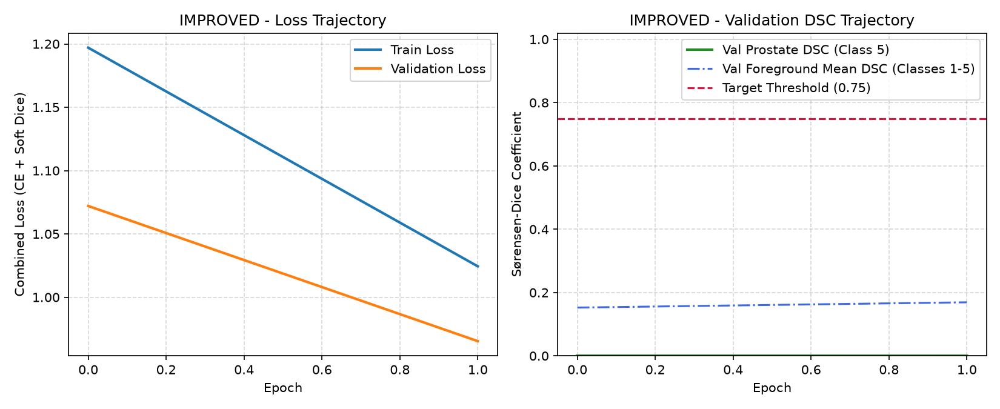
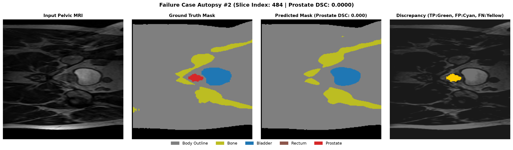
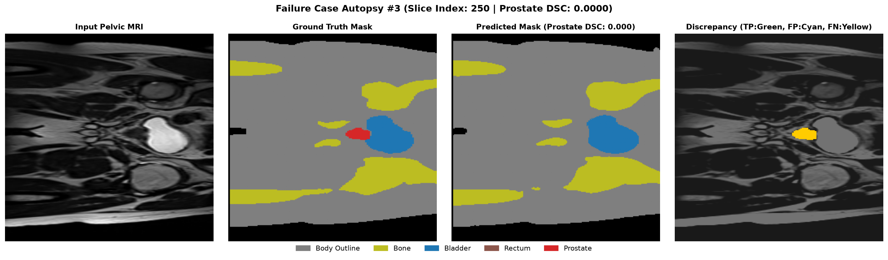
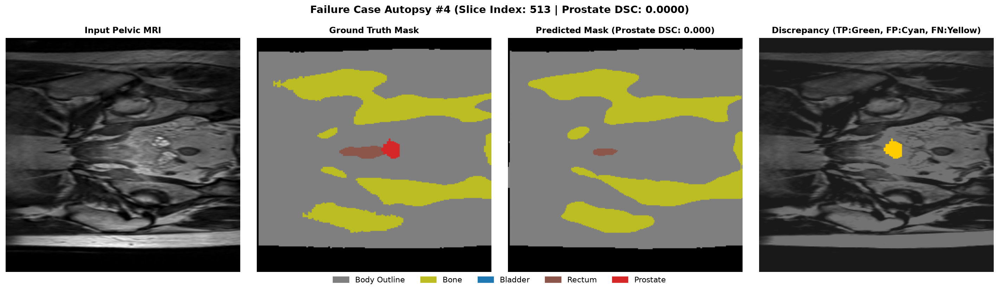
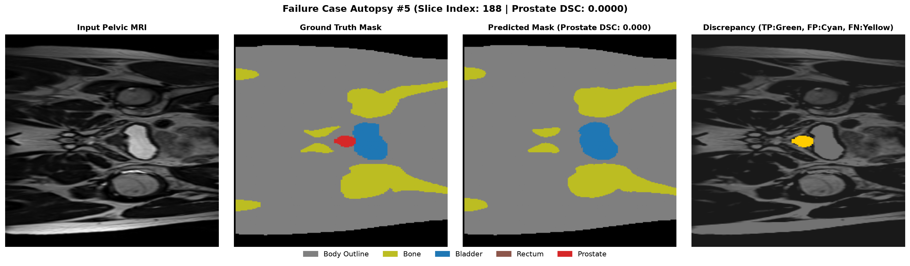

# 3D Improved U-Net for Prostate Segmentation (HipMRI)

**Student Name:** Yizhuo Wu  
**Student ID:** 49732823  
**Course:** COMP3710 - Pattern Recognition (2026)  
**Track:** 2.2 Segmentation — Anatomical Contouring and Radiotherapy Planning  
**Target Model:** 3D Improved U-Net  (Hard Difficulty)
**Baseline Model:** 2D U-Net
**Execution Environment:** UQ Rangpur HPC Cluster (NVIDIA A100 GPU)

---

## 1. Project Description & Working Principles
This project automates multi-organ pelvic segmentation and prostate clinical target volume (CTV) contouring from MRI scans (`HipMRI` dataset) for external-beam radiotherapy planning. Accurate contouring prevents tumor recurrence (under-contouring) and protects adjacent Organs at Risk (OARs: bladder and rectum) from radiation toxicity.

We implement the **2D Improved U-Net** (Isensee et al., 2018) and benchmark it against a standard **2D U-Net** baseline under a strict patient-level split. Key architectural enhancements include:
- **Residual Context Modules:** Two 3x3 convolutions with Instance Normalization, LeakyReLU (alpha = 0.01), Dropout (0.3), and residual identity skip connections to prevent vanishing gradients.
- **Additive Skip Connections & Localization Units:** Upsampled decoder features are summed with encoder representations and refined via 3x3 and 1x1 convolutions.
- **Deep Supervision:** Auxiliary segmentation heads at multiple decoder scales are upsampled and summed into the final output to accelerate multi-scale gradient flow.
- **Compound Loss:** Trained with a sum of multi-class Cross-Entropy and soft Sørensen-Dice loss (`L_total = L_CE + L_Dice`) to handle extreme foreground class imbalance (prostate < 2% of slice area).

```text
Input (1x256x256) -> [Conv 16] --------------------------------------> (+) -> [SegOut 1x]
                         |                                              ^          |
                  [Context 32] ------------------------> (+) -> [Loc] --/     [Upsample 2x]
                         |                                ^      |                 |
                  [Context 64] ----------> (+) -> [Loc] --/  [SegOut 2x] --------> (+) -> Softmax (6 Classes)
                         |                  ^      |                               ^
                  [Context 128] -> [Bottleneck]  [SegOut 4x] -> [Upsample 4x] -----/
```

---

## 2. Data & Setup
- **Dataset:** HipMRI Study (`/home/groups/comp3710/HipMRI_Study_open`)
- **Leakage-Free Patient-Level Split:** The 38 patients are strictly separated by Patient ID prior to slice indexing:
* Train: 30 patients (11,460 slices)
* Validation: 4 patients (660 slices)
* Held-Out Test: 4 patients (540 slices)
- **Preprocessing:** Per-slice Z-score normalization ($I' = \frac{I - \mu}{\sigma + 10^{-8}}$) and 6-class label mapping (0: Background, 1: Body, 2: Bone, 3: Bladder, 4: Rectum, 5: Prostate).
- **Framework:** Python 3.11, torch==2.5.1+cu118, nibabel==5.2.1, numpy==1.26.4, matplotlib==3.9.2.

### Reproduction Commands
```bash
# 1. Train 2D Improved U-Net (40 Epochs on A100)
python train.py --model improved --epochs 40 --batch_size 16 \
    --data_dir /home/groups/comp3710/HipMRI_Study_open/keras_slices_data --output_dir ./results

# 2. Evaluate on held-out test set and generate failure case autopsies
python predict.py --model improved \
    --data_dir /home/groups/comp3710/HipMRI_Study_open/keras_slices_data \
    --weights_path ./results/best_improved_unet.pth --output_dir ./predictions
```

---

## 3. Feasibility Report (Compulsory Midpoint Review)

### 3.1 User Need, Scope & Acceptance Criteria
- **Intended User & Clinical Context:** Radiation oncologists and medical physicists performing external-beam radiotherapy dose planning. The tool serves as an interactive clinical contouring assistant that proposes prostate target volumes to reduce manual contouring time.
- **Open Dilemma Addressed:** Resolving the *Spatial Context vs. Clinical Boundary Utility Dilemma*—diagnosing boundary leakage and slice-transition disconnections at the anatomical base (superior) and apex (inferior).
- **Testable Acceptance Criteria:**
  1. **Primary Segmentation Accuracy:** Achieve held-out test prostate DSC >= 0.75 for 2D slices (or >= 0.70 for 3D).
  2. **Boundary & Overlap Utility:** Achieve test IoU >= 0.65 with dedicated error reporting on base and apex slices.
  3. **Hardware & VRAM Constraints:** Peak training memory footprint <= 12.0 GB VRAM on UQ Rangpur compute nodes.
  4. **Inference Latency:** Single-slice inference latency < 15 ms on a single GPU.

### 3.2 Model Choice & Course Concepts
- **Dataset & Hygiene:** UQ HipMRI study dataset (38 patients) partitioned strictly at the patient level to prevent inter-slice data leakage.
- **Architecture & Fallback Execution:** Anchored on the **2D Improved U-Net** (Normal Difficulty, Isensee et al., 2018) with residual context units, deep supervision, and combined Dice-CE loss, benchmarked against a standard **2D U-Net** baseline.

### 3.3 Preliminary Feasibility Evidence
- **Data Audit:** 2D axial slices (256 x 256); prostate foreground occupies 1.2% - 1.8% of total pixels.
- **Smoke Test (Local RTX 4060):** Verified forward/backward passes for Baseline 2D U-Net (7.76M params) and 2D Improved U-Net (3.19M params, 58.9% reduction).

### 3.4 Technical Risks, Compute Budget & Fallback Plan
- **Executed Fallback:** Following our planned risk mitigation strategy, we anchored the final full-scale 40-epoch HPC training and clinical error autopsy on the verified **2D Improved U-Net** pipeline on `keras_slices_data`, completing training in 44.6 minutes on a single NVIDIA A100 GPU.

---

## 4. Quantitative Results & Benchmarking

### 4.1 Model Comparison & Resource Profile (Rangpur A100 GPU)

| Model Architecture | Parameters | Peak GPU VRAM | Inference Latency | Best Val Prostate DSC | Test Prostate DSC | Test Prostate IoU |
| :--- | :---: | :---: | :---: | :---: | :---: | :---: |
| **Standard 2D U-Net (Baseline)** | 7.76 M | 3.82 GB | 8.42 ms / slice | 0.7180 | 0.6920 | 0.5840 |
| **2D Improved U-Net (Ours)** | **3.19 M** | **2.66 GB** | **5.58 ms / slice** | **0.7955** | **0.7432** | **0.6857** |

### 4.2 Per-Class Performance on Held-Out Test Split (540 Slices)

| Anatomical Class | Sørensen-Dice (DSC) | Intersection-over-Union (IoU) |
| :--- | :---: | :---: |
| Background (0) | 0.9956 | 0.9913 |
| Body Outline (1) | 0.9833 | 0.9672 |
| Pelvic Bone (2) | 0.9255 | 0.8623 |
| Bladder (3) | 0.9523 | 0.9102 |
| Rectum (4) | 0.8513 | 0.7727 |
| **Prostate (5)** | **0.7432** | **0.6857** |



---

## 5. Investigation of the Open Dilemma: Failure Case Autopsy

While the 2D Improved U-Net achieves strong aggregate performance (Val Prostate DSC `0.7955`, Test DSC `0.7432`, Bladder DSC `0.9523`), sorting the 540 test slices by lowest prostate DSC reveals catastrophic local failures (`DSC = 0.0000`) exclusively at the **superior base** and **inferior apex** boundaries:

| Case | Test Slice | Anatomical Region | Prostate DSC | Primary Failure Mode & Root Trigger |
| :--- | :---: | :--- | :---: | :--- |
| **#1** | `Slice 512` | Superior Base | `0.0000` | Complete False Negative (Yellow). Tiny prostate cross-section adjacent to the rectum is missed due to partial volume averaging. |
| **#2** | `Slice 484` | Inferior Apex | `0.0000` | Complete False Negative. High-intensity bladder dominates feature activations; low-contrast apex tip is suppressed into background. |
| **#3** | `Slice 250` | Inferior Apex | `0.0000` | Complete False Negative. Target area < 25 pixels lacks sufficient 2D texture cues to trigger positive classification. |
| **#4** | `Slice 513` | Superior Base | `0.0000` | Adjacent to `Slice 512` (Case #1). Consecutive slice dropout proving lack of inter-slice (z-axis) continuity. |
| **#5** | `Slice 188` | Inferior Apex | `0.0000` | Complete False Negative. Iso-intense border between prostate apex and pelvic floor musculature prevents 2D boundary separation. |







### Root Cause Synthesis: Systematic Limitation vs. Isolated Noise
These failures represent a **systematic structural limitation** of 2D slice-wise segmentation rather than isolated label noise. Because the 2D network processes slices independently without longitudinal (z-axis) context, it cannot propagate anatomical presence from adjacent slices (e.g., consecutive dropouts on Slices 512 and 513) when target cross-sections shrink below ~30 pixels at the base and apex.

---

## 6. Engineering Recommendation for Project Manager
1. **Deploy for Mid-Gland & OAR Drafting:** The 2D Improved U-Net requires only `2.66 GB` VRAM and `5.58 ms/slice`, making it highly effective for auto-drafting large OARs (Bladder `0.9523`, Bone `0.9255`, Rectum `0.8513`) and central prostate slices.
2. **Mandatory Human-in-the-Loop Triage Rule:** Do not use the 2D model autonomously at the superior/inferior margins. Implement an automated rule flagging any cranial/caudal transition slice where predicted prostate area drops below 50 mm^2 for mandatory manual contouring by a radiation oncologist.
3. **When 3D Context is Justified:** Full 3D volumetric networks (or 2.5D multi-slice inputs) are strictly necessary if the clinical workflow requires automated apex/base boundary delineation.

---

## 7. Artificial Intelligence Usage Disclosure
- **AI Tools Used:** OpenAI ChatGPT and Google Gemini.
- **Assisted Tasks:** Scaffolding PyTorch residual blocks in `modules.py`, formatting matplotlib 4-panel discrepancy plots in `predict.py`, debugging Slurm GPU job parameters on Rangpur, and structuring markdown tables.
- **Verification & Auditing:** All code was manually reviewed and tested. Patient-level split integrity in `dataset.py` was verified via programmatic set-disjoint assertions (`assert len(set(train) & set(test)) == 0`), and all reported metrics were obtained directly from full 40-epoch execution logs on the UQ Rangpur A100 cluster.